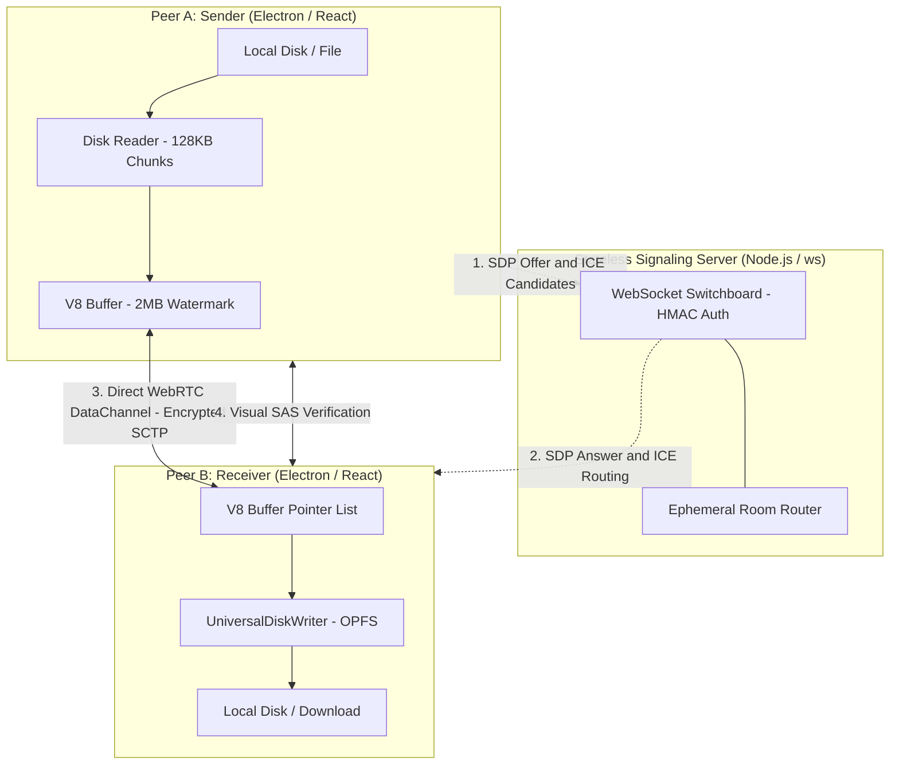

# DropWire

> Anonymous, zero-cloud peer-to-peer workspace for multi-gigabyte file streaming, encrypted chat, voice/video calls, and 60 FPS screen sharing.

---

## Project Purpose

This repository is published strictly for personal educational and architectural demonstration purposes. It is intended as an exhibition piece to showcase low-level WebRTC networking, memory management with the Origin Private File System (OPFS), and desktop integration using Electron.

---

## The Problem and The Solution

* **The Problem:** Cloud messaging apps (Discord, Telegram, Slack) enforce strict 25 MB to 2 GB upload limits, log user metadata, and require personal accounts. Transferring multi-gigabyte files usually forces users to upload to third-party cloud storage first, wait twice (upload then download), and leave an unnecessary data trail on central servers.
* **The Solution:** DropWire establishes direct device-to-device WebRTC data pipes. Files stream directly hard-drive-to-hard-drive using the Origin Private File System (OPFS), resulting in zero cloud storage overhead, zero server data retention, and near-zero RAM consumption during gigabyte-scale transfers.

---

## System Architecture

Below is the network and memory topology of DropWire:

---

## Key Engineering Highlights

### 1. Zero-RAM Disk Streaming (OPFS)
Buffering multi-gigabyte files in Chromium/V8 JavaScript heap memory causes immediate out-of-memory crashes. DropWire uses the Origin Private File System (OPFS):
* Large outbound files are sliced sequentially from disk in 128 KB micro-chunks.
* Inbound chunks bypass RAM accumulation and flush directly to persistent local disk handles.
* Keeps application RAM footprint flat (~150 MB) whether transferring a 10 MB document or a 10 GB disk image.

### 2. High-Throughput Backpressure Management
Direct WebRTC DataChannel streaming can congest Chromium internal C++ DTLS threads if unpaced. DropWire utilizes an event-driven `bufferedAmountLowThreshold` (512 KB) and a 2 MB sliding high-water mark to prevent UDP packet saturation and maintain continuous wire speeds.

### 3. Ephemeral Zero-Knowledge Identity
* **No Accounts or Phone Numbers:** Users connect via disposable 7-digit line IDs.
* **Multi-Stage Cipher Pipeline:** Chat messages and voice notes are encrypted device-to-device using `PBKDF2-HMAC-SHA512` key derivation, bitwise scrambling, and `AES-256-GCM`.
* **Man-in-the-Middle (MitM) Defense:** Both peers independently compute and visually verify a 4-digit Short Authentication String (SAS) derived directly from DTLS session fingerprints.

### 4. 60 FPS Desktop Capture Without Windows Borders
Configured with custom Electron capture flags (DXGI/GDI bypass) that eliminate the Windows Graphics Capture yellow selection border, supporting clean 60 FPS desktop streaming with loopback audio routing.

---

## Tech Stack

* **Desktop Framework:** Electron, Node.js
* **Frontend:** React 19, Vite, TailwindCSS
* **Networking and Transport:** WebRTC (DataChannels, MediaStreams), WebSockets
* **Storage and Hardware:** Origin Private File System (OPFS), Web Audio API, Web Crypto API
* **Security:** AES-256-GCM, PBKDF2-HMAC-SHA512, Short Authentication Strings (SAS)